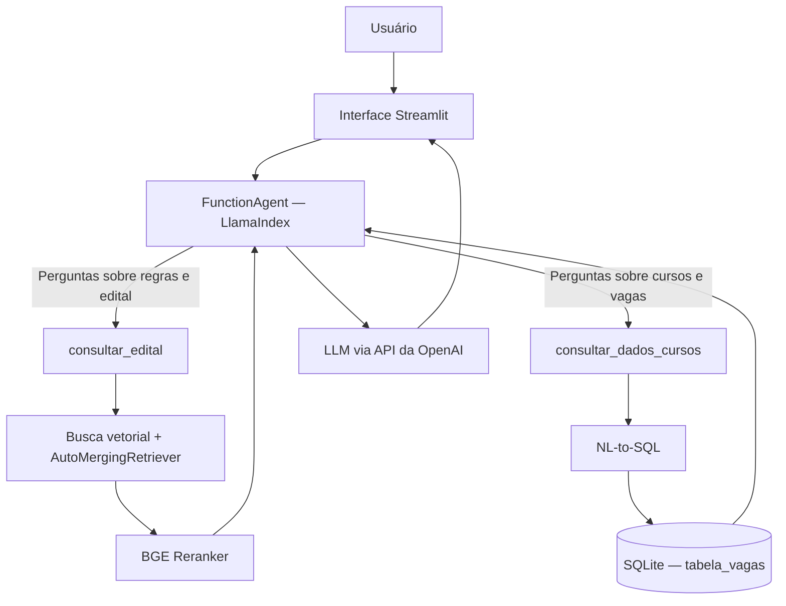

# Assistente Inteligente — Vestibular Unicamp 2027

Assistente virtual de inteligência artificial para consultar informações do **Vestibular Unicamp 2027** em linguagem natural. O projeto combina **RAG (Retrieval-Augmented Generation)** para perguntas sobre o edital com **consultas SQL** para informações estruturadas de cursos e vagas.

> **Status:** protótipo desenvolvido para execução local. As respostas devem ser conferidas nas publicações oficiais da Unicamp; o assistente não substitui o edital.

## Funcionalidades

- Perguntas e respostas em linguagem natural sobre o edital do Vestibular Unicamp 2027.
- Recuperação semântica de trechos do edital com embeddings e busca vetorial.
- Refinamento dos resultados por *reranking* e recuperação hierárquica de contexto.
- Consultas a informações estruturadas de cursos e vagas por meio de linguagem natural convertida em SQL (*NL-to-SQL*).
- Seleção de ferramentas por um agente de IA, de acordo com a pergunta do usuário.
- Interface de chat desenvolvida com Streamlit.

## Tecnologias

| Tecnologia | Utilização |
| --- | --- |
| **Python** | Linguagem principal |
| **Streamlit** | Interface web do chatbot |
| **LlamaIndex** | Orquestração do agente, recuperação documental e NL-to-SQL |
| **OpenAI API** | Modelo de linguagem para interpretação das perguntas e geração de respostas |
| **BAAI/bge-m3** | Geração local de embeddings |
| **BAAI/bge-reranker-base** | Reranking dos trechos recuperados |
| **VectorStoreIndex / AutoMergingRetriever** | Indexação vetorial e recuperação hierárquica |
| **SQLite** | Consulta aos dados estruturados de cursos e vagas |

## Arquitetura



O agente pode utilizar uma ou mais ferramentas conforme a necessidade da pergunta. A escolha é feita pelo modelo de linguagem a partir das instruções e descrições das ferramentas, e não por regras fixas baseadas em palavras-chave.

### Pipeline RAG

1. O edital é processado e dividido em trechos.
2. O modelo **BGE-M3** gera representações vetoriais dos trechos.
3. Os vetores são armazenados em um índice persistente.
4. A pergunta do usuário é usada para recuperar trechos semanticamente relevantes.
5. O **AutoMergingRetriever** pode reunir contexto relacionado, e o **BGE Reranker** reordena os resultados.
6. Os trechos selecionados são fornecidos ao LLM como contexto para a resposta.

### Consultas estruturadas

Os dados de cursos e vagas são carregados do arquivo `data/anexo_3_vagas.csv` em uma tabela SQLite chamada `tabela_vagas`. O **NLSQLTableQueryEngine**, do LlamaIndex, permite traduzir perguntas em linguagem natural para consultas SQL.

## Executando localmente

### Pré-requisitos

- Python e ambiente virtual configurados.
- Dependências do projeto instaladas (conforme o arquivo de dependências do repositório).
- Chave de API da OpenAI válida.
- Arquivos de dados e índice necessários disponíveis localmente.

### 1. Preparar o ambiente

Em Linux ou WSL:

```bash
# A partir da pasta do projeto
python3 -m venv venv
source venv/bin/activate
```

Instale as dependências conforme a configuração efetiva do repositório. **Se houver um `requirements.txt`:**

```bash
pip install -r requirements.txt
```

### 2. Configurar a API

Defina a variável de ambiente `OPENAI_API_KEY` antes de iniciar a aplicação:

```bash
export OPENAI_API_KEY="sua_chave_aqui"
```

Não inclua chaves de API no código nem as envie ao GitHub. Caso o projeto utilize um arquivo `.env`, mantenha-o fora do controle de versão.

### 3. Iniciar o chatbot

```bash
python -m streamlit run test_agent.py --server.fileWatcherType none
```

Abra no navegador o endereço local informado pelo Streamlit (normalmente `http://localhost:8501`).

> **Observação:** o comando acima corresponde à configuração local utilizada durante o desenvolvimento. A instalação e o carregamento inicial dos modelos podem exigir internet. Mesmo após carregar os modelos locais, a geração de respostas depende de acesso à API da OpenAI.

## Exemplos de perguntas

- Qual é o valor da taxa de inscrição do Vestibular Unicamp 2027?
- Quais são as regras para solicitar isenção da taxa?
- Quantas vagas estão disponíveis para determinado curso?
- Quais são as datas das provas?
- Quais são as regras de inscrição e quantas vagas existem para o curso escolhido?

As perguntas podem exigir consulta ao edital, aos dados estruturados ou a ambas as fontes. Os resultados dependem da cobertura dos documentos e dados carregados.

## Avaliação experimental

Durante os testes do mecanismo de consulta, foram registrados os seguintes tempos de **execução das ferramentas**:

| Métrica | Resultado |
| --- | ---: |
| Execuções registradas | 71 |
| Tempo médio | 15,78 s |
| Mediana | 12,55 s |
| Menor tempo | 3,10 s |
| Maior tempo | 40,68 s |

**Importante:** essas métricas não representam necessariamente a latência completa percebida pelo usuário, pois não incluem obrigatoriamente todas as etapas da interação. A avaliação é exploratória; os números acima não constituem uma medição de acurácia factual do chatbot.

## Limitações e melhorias futuras

- Avaliar sistematicamente a correção factual e a fidelidade das respostas ao edital.
- Medir separadamente a latência de recuperação, reranking, consultas SQL e geração pelo LLM.
- Reduzir o consumo de memória dos componentes locais.
- Testar diferentes configurações de recuperação e reranking com um conjunto fixo de perguntas.
- Implementar observabilidade, controles de acesso e testes de carga antes de uma eventual disponibilização pública.
- Validar as consultas SQL geradas e restringir privilégios em cenários de produção.

## Aviso

Este projeto é uma iniciativa independente para fins de estudo e demonstração técnica. **Não é um canal oficial da Unicamp.** Para decisões sobre inscrições, provas, vagas e regras, consulte sempre os documentos e comunicados oficiais da instituição.

